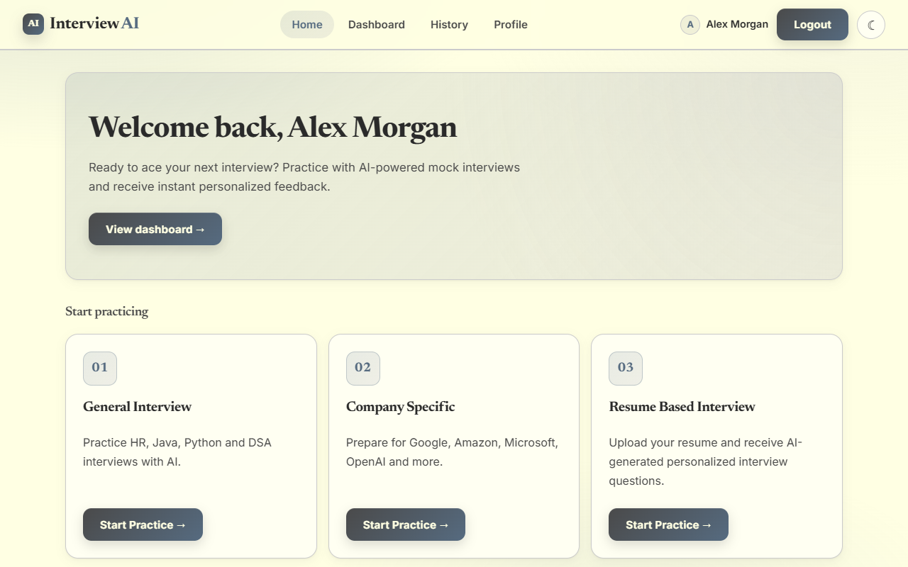
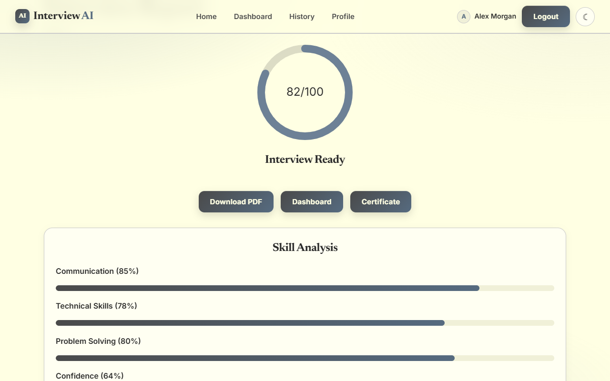
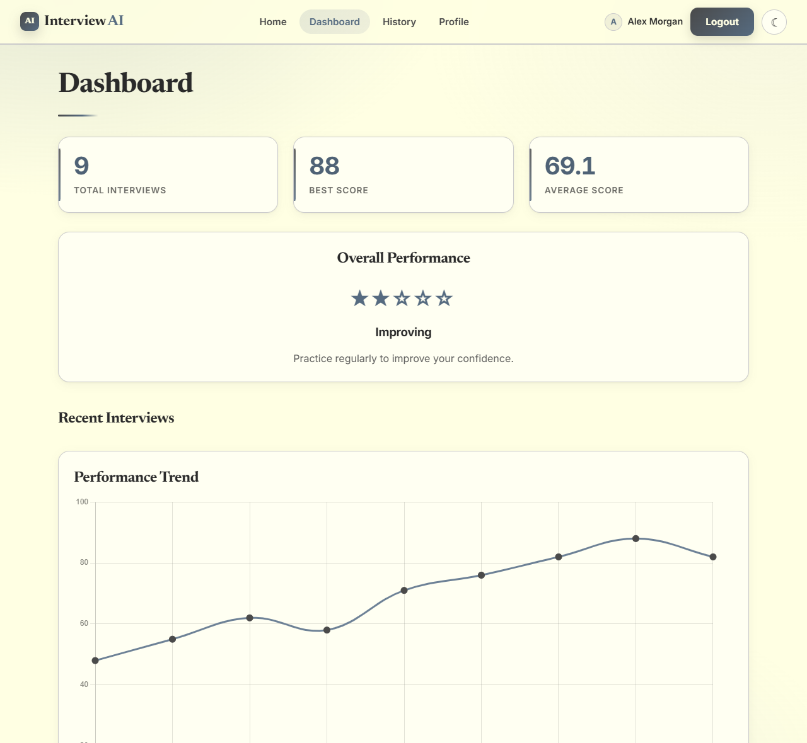
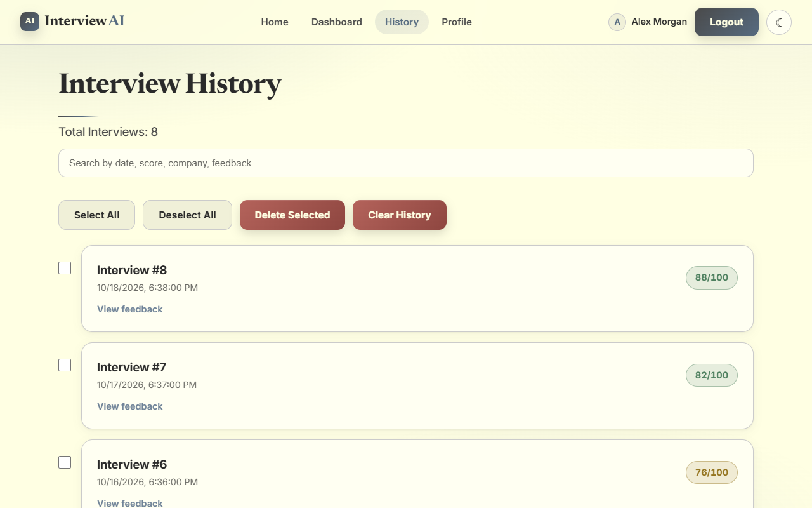
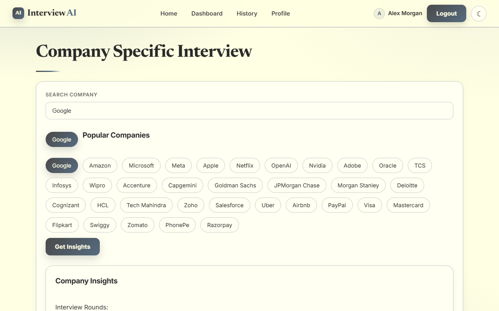
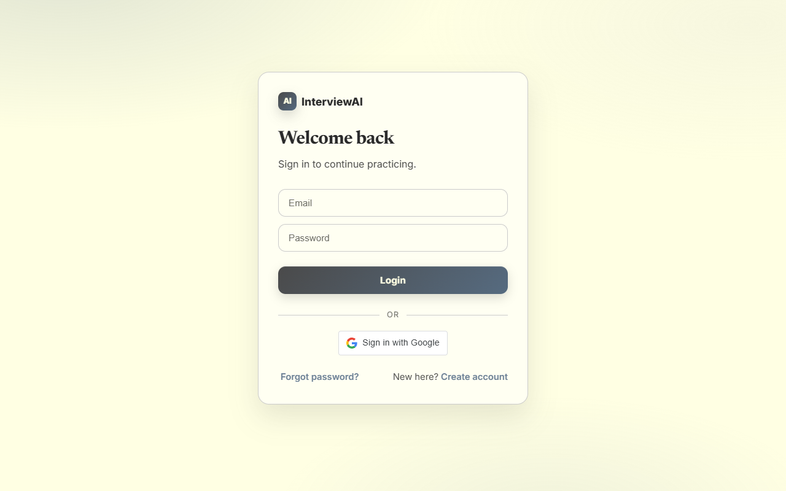

# InterviewAI

An AI-powered mock interview platform. Practice general, company-specific or resume-based interviews, answer by typing or speaking, and get a scored report with strengths, weaknesses and an improvement plan.

**Live demo:** https://interview-ai-three-coral.vercel.app
(The backend runs on a free tier, so the first request after a period of inactivity can take 30-60 seconds while it wakes up.)

| | |
|---|---|
|  |  |
|  |  |
|  |  |

---

## Features

**Interview practice**
- General interviews (Java, Python, DSA, HR) with selectable difficulty and question count
- Company-specific interviews for 30+ companies, with per-company round and focus-area insights
- Resume-based interviews: upload a PDF and get five questions generated from your skills and projects
- Timed sessions with a countdown, voice answers through the browser's Web Speech API, and a webcam preview
- If time runs out, the remaining questions are submitted as unanswered and the interview is still evaluated

**Feedback and tracking**
- AI evaluation with an overall score and communication, technical, problem-solving and confidence ratings
- Report with strengths, weaknesses, suggestions and a personalised improvement plan
- Download the report or a completion certificate as PDF
- History with search, multi-select delete and score badges
- Dashboard with totals, best and average score, and a score-trend chart
- Profile page with change username and change password

**Accounts**
- Email and password registration and login (bcrypt-hashed passwords, JWT sessions)
- Google sign-in
- Forgot password with a one-time code sent by email (expires after 5 minutes)
- Light (ink wash paper) and dark themes, remembered between visits

---

## Tech stack

| Layer | Technology |
|---|---|
| Frontend | React 19, Vite, React Router, Axios, Chart.js, Framer Motion, jsPDF, react-webcam |
| Backend | Python, Flask, Flask-SQLAlchemy, Flask-Bcrypt, PyJWT, Flask-CORS, gunicorn |
| AI | Google Gemini (`gemini-2.5-flash`, falling back to `gemini-2.5-flash-lite`) |
| Documents | pypdf for resume parsing |
| Auth and email | Google OAuth (`google-auth`), Brevo transactional email for OTPs |
| Database | PostgreSQL in production, SQLite for local development |
| Hosting | Vercel (frontend), Render (backend and database) |

---

## How it works

```
Browser (React SPA)  ──HTTPS + JWT──►  Flask API  ──►  PostgreSQL
                                          │
                                          ├──►  Gemini API  (questions, evaluation)
                                          ├──►  Brevo API   (password-reset OTP email)
                                          └──►  Google      (ID-token verification)
```

- The frontend sends the JWT in an `Authorization: Bearer` header. Every data endpoint takes the user from the token, so a user can only read or delete their own history.
- The AI endpoints sit behind authentication, so the Gemini quota can't be used anonymously.
- The evaluation prompt asks Gemini for a fixed format (`SCORE`, `COMMUNICATION`, ...), which the report page parses into the score ring and skill bars.

### API overview

| Method | Route | Auth | Purpose |
|---|---|---|---|
| POST | `/register`, `/login`, `/google-login` | no | Create account, sign in |
| POST | `/send-otp`, `/reset-password` | no | Password reset with emailed code |
| POST | `/generate-questions` | yes | Generate interview questions |
| POST | `/upload-resume` | yes | Questions from a PDF resume |
| POST | `/evaluate` | yes | Score a set of answers |
| POST | `/company-insights` | yes | Rounds, focus areas and tips for a company |
| POST | `/save-interview` | yes | Save a finished interview |
| GET | `/user-history/<id>`, `/profile/<id>` | yes (own id) | History and stats |
| DELETE | `/delete-interview/<id>`, `/clear-history/<id>` | yes (own data) | Remove interviews |
| PUT | `/change-username`, `/change-password`, `/update-profile` | yes | Account changes |

---

## Run it locally

You need Node 20+ and Python 3.11+.

```bash
git clone https://github.com/hansikhagarine31/InterviewAI.git
cd InterviewAI
```

**Backend**

```bash
cd backend
python -m venv venv
venv\Scripts\activate        # macOS/Linux: source venv/bin/activate
pip install -r requirements.txt
# create backend/.env with GEMINI_API_KEY and SECRET_KEY (see the table below)
python app.py                # http://127.0.0.1:5000
```

**Frontend** (in a second terminal, from the project root)

```bash
npm install
# optional: create .env with VITE_GOOGLE_CLIENT_ID for Google sign-in
npm run dev                  # http://localhost:5173
```

Without `DATABASE_URL` the backend uses a local SQLite file, so no database setup is needed.

### Environment variables

**Backend (`backend/.env`)**

| Variable | Required | Notes |
|---|---|---|
| `GEMINI_API_KEY` | yes | From https://aistudio.google.com/apikey |
| `SECRET_KEY` | yes in production | Signs JWTs. Generate with `python -c "import secrets; print(secrets.token_hex(32))"` |
| `ALLOWED_ORIGINS` | in production | Comma-separated frontend URLs for CORS. Defaults to `*` |
| `DATABASE_URL` | in production | PostgreSQL URL. Defaults to local SQLite |
| `GOOGLE_CLIENT_ID` | for Google sign-in | Must match the frontend value |
| `BREVO_API_KEY` | for password reset | Brevo v3 API key |
| `MAIL_SENDER` | for password reset | Sender address verified in Brevo |

**Frontend (`.env`)**

| Variable | Notes |
|---|---|
| `VITE_API_URL` | Backend URL. Defaults to `http://127.0.0.1:5000` |
| `VITE_GOOGLE_CLIENT_ID` | Google OAuth client ID |

---

## Project structure

```
InterviewAI/
├── backend/
│   ├── app.py              # Flask app: models, auth, AI, history, profile routes
│   ├── requirements.txt
│   └── Procfile            # gunicorn entry for Render
├── src/
│   ├── api/client.js       # Axios instance: base URL, auth header, 401 handling
│   ├── components/         # Navbar, ProtectedRoute
│   ├── pages/              # Home, Interview, Report, Dashboard, History, Profile, ...
│   └── index.css           # Design system: tokens, themes, components
├── docs/screenshots/
├── DEPLOYMENT.md
├── render.yaml             # Render Blueprint for the backend
└── vercel.json             # SPA rewrite for the frontend
```

See [DEPLOYMENT.md](DEPLOYMENT.md) for how to deploy it.

---

## Known limitations

- Password-reset codes are kept in server memory, so they are lost if the backend restarts and don't work across multiple workers. Redis or a database table would fix this.
- The login token is stored in `localStorage`, which is common for SPAs but exposed if an XSS bug is ever introduced.
- There is no rate limiting on login or OTP requests yet.
- There are no automated tests; the app was verified with manual and browser-driven end-to-end runs.
- The webcam image is captured at the end of an interview but is not analysed.

## Ideas for next steps

- Rate limiting, a persistent OTP store and email verification
- Automated tests and CI
- Per-question scoring and feedback
- More company question sets

---

## Author

**Hansikha Garine**

GitHub: https://github.com/hansikhagarine31
LinkedIn: https://www.linkedin.com/in/hansikhagarine31/
